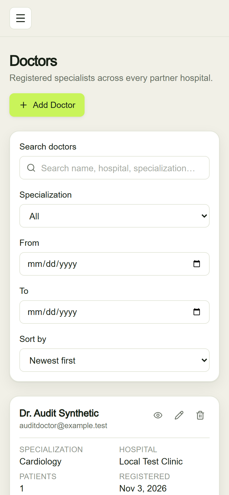
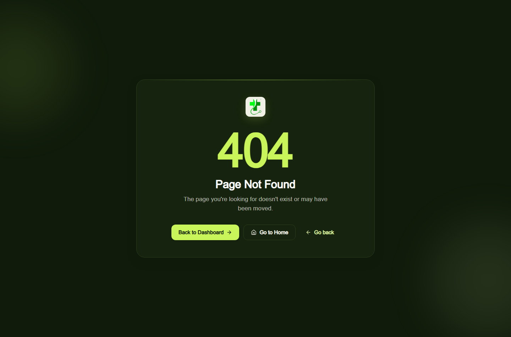
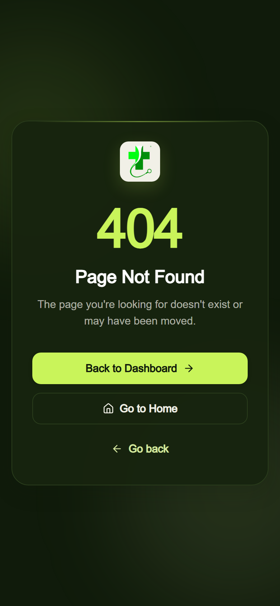

# Doctor Tracker Client

Doctor Tracker is an admin portal for managing doctor and patient records. It pairs a responsive healthcare dashboard and record workflows with operational analytics served by the separate Doctor Tracker Express API.

## Features

- Admin login and session verification through an HttpOnly API cookie.
- Doctor and patient lists with search, filters, sorting and server pagination.
- Create, view, update and delete workflows, including doctor patient rosters.
- Dashboard and analytics charts backed by API aggregation results.
- Responsive navigation, reusable forms, tables, loading and empty states.

## Stack

Next.js App Router (JavaScript), React, Tailwind CSS, TanStack Query, React Hook Form, Zod, Recharts, Framer Motion and Lucide React.

## Local setup

1. Install Node.js 20 or newer.
2. In this repository, run `npm ci`.
3. Copy `.env.example` to `.env.local` and set `NEXT_PUBLIC_API_URL` to the Express API base URL (default `http://localhost:4000/api/v1`).
4. Start the backend separately, then run `npm run dev`.
5. Open `http://localhost:3000`. Create an admin using the backend's `seed:admin` script and its environment configuration.

## Environment

| Variable | Purpose | Local default |
|---|---|---|
| `NEXT_PUBLIC_API_URL` | Versioned Express API base URL | `http://localhost:4000/api/v1` |

Never put credentials or private API secrets in `NEXT_PUBLIC_*`; Next.js exposes these values to the browser.

## Architecture

The browser renders the Next.js app and uses TanStack Query hooks to call `src/lib/api.js`. That shared HTTP client sends credentials with `fetch` and never stores JWTs in browser storage. The standalone Express service validates the HttpOnly cookie and reads/writes MongoDB. The Next.js app does not implement business API routes.

## Technical decisions

1. **Keep the API in a separate Express service.** This preserves independent client/server deployment and keeps authentication, validation and data rules in one REST API rather than coupling them to Next route handlers.
2. **Use TanStack Query for server state.** Query keys, mutation invalidation, loading/error states and cached results are centralized around API data. React Hook Form and Zod handle field state and client-side validation, while the API repeats validation at the trust boundary.

## Project layout

```text
src/app/          App Router pages
src/components/   Shared layout and UI components
src/features/     Doctor and patient forms and schemas
src/hooks/        Query and mutation hooks
src/lib/          API client and helpers
src/providers/    Query and toast providers
src/styles/       Global styles and design tokens
```

## Checks

- `npm test` — Vitest component, schema and utility tests.
- `npm run build` — optimized Next.js production build.

## Deployment

This repository is the Vercel project root; deploy the API separately as a Render Web Service (see the server repository README).

1. In Vercel, choose **Add New → Project**, import `shahed-hassan-fz-rabbi/doctor-tracker-client`, and select branch `main`.
2. Set Framework Preset to **Next.js** and Root Directory to `.`. Use Install Command `npm ci` and Build Command `npm run build`; leave Output Directory at the Next.js default (do not override it).
3. Add `NEXT_PUBLIC_API_URL` under **Environment Variables** for Production. Set it to the actual Render service URL followed by `/api/v1` (for example, `https://<your-render-service>.onrender.com/api/v1`). This URL is public; never put credentials or backend secrets in a `NEXT_PUBLIC_*` variable.
4. Deploy. Copy the actual production origin shown by Vercel (scheme and hostname only; no path or trailing slash) into the backend's `CORS_ORIGINS` setting on Render.
5. If you use Vercel Preview deployments, add `NEXT_PUBLIC_API_URL` for Preview as well and add the exact preview origin(s) to the API allow-list. Do not use `*` with credentialed CORS.
6. After changing an environment variable, redeploy the affected service so the new build/runtime receives it.

In Render, use `COOKIE_SECURE=true` and HTTPS. The API sets the session cookie `Secure; HttpOnly; SameSite=None` for the separate Vercel and Render sites. Browser privacy settings may still block cross-site cookies; verify login on the deployed domains. If blocked, use compatible custom domains under one site or an API proxy architecture rather than weakening cookie/CORS security.

Because the JWT is stored in an HttpOnly cookie owned by the API domain, route protection is verified in the browser through `/auth/me` (`AuthGuard`), not in Next.js middleware. Keep the API and client on HTTPS in production.

No live deployment has been created from this repository. The example hostname above is a placeholder; use the domain Vercel actually assigns.


## Visual evidence

Screenshots were captured from the running app against the development API.

### Desktop

| Login | Dashboard |
|---|---|
|  |  |

| Doctors | Patients |
|---|---|
|  |  |

| Analytics | Doctor detail |
|---|---|
|  |  |

### Mobile (390 × 844)

| Dashboard | Doctors | Patients |
|---|---|---|
|  |  |  |

### Not Found

| Desktop | Mobile |
|---|---|
|  |  |

