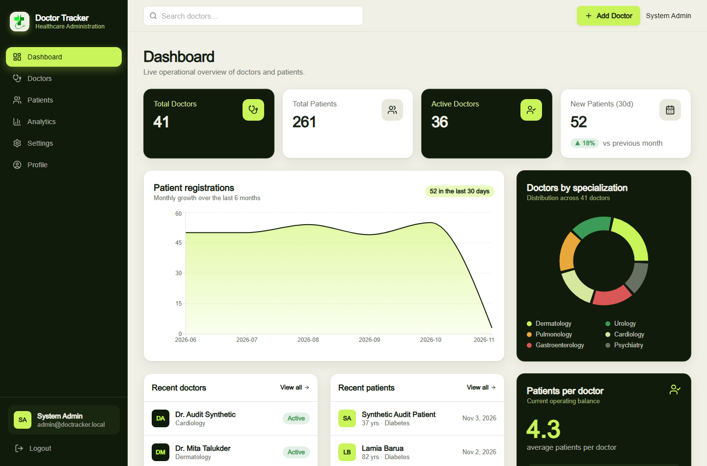
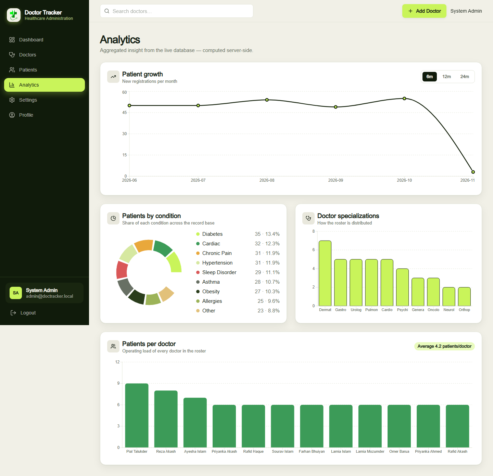
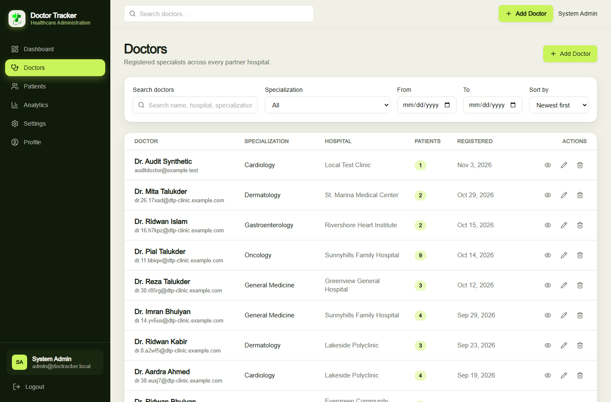
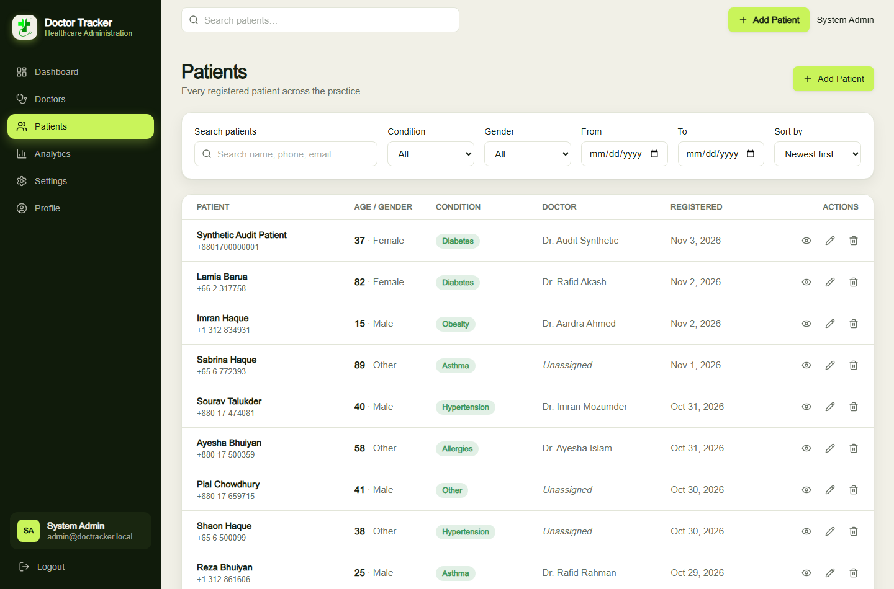
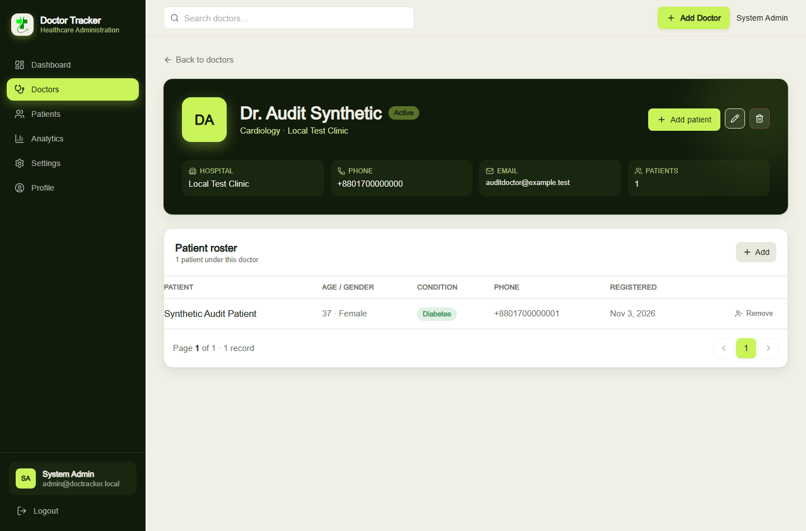
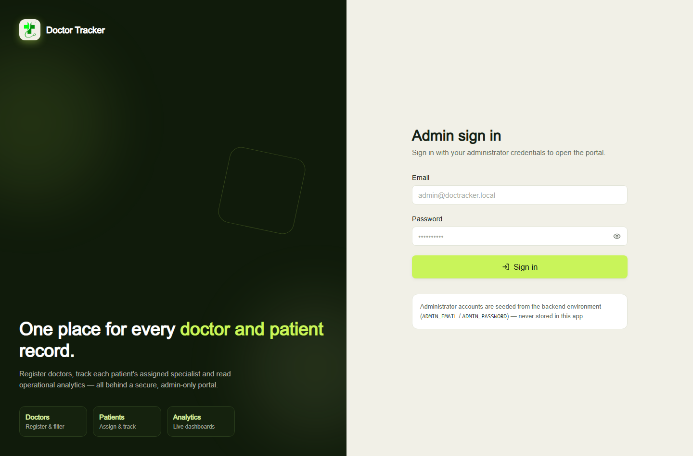
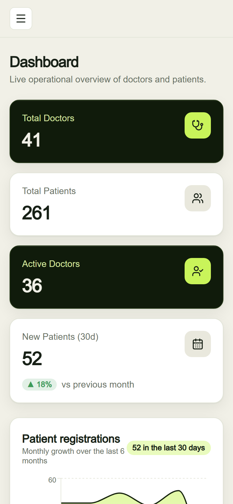
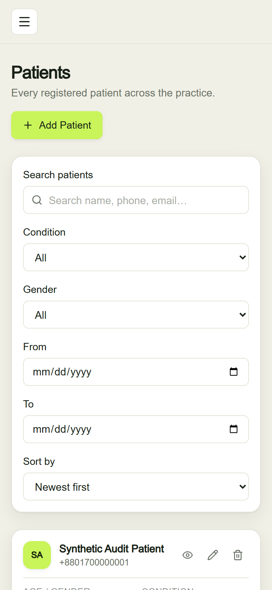
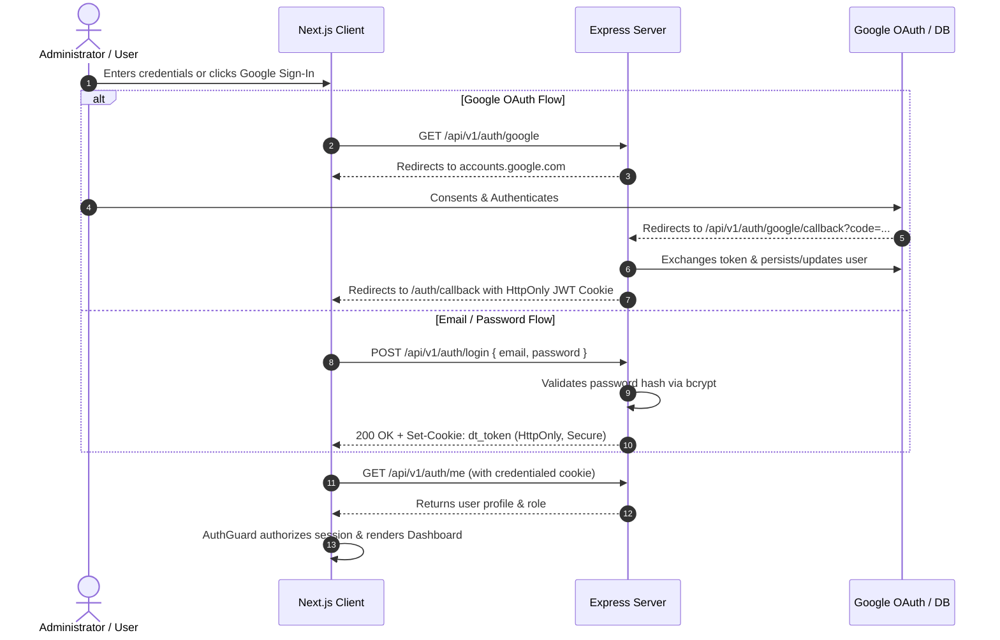
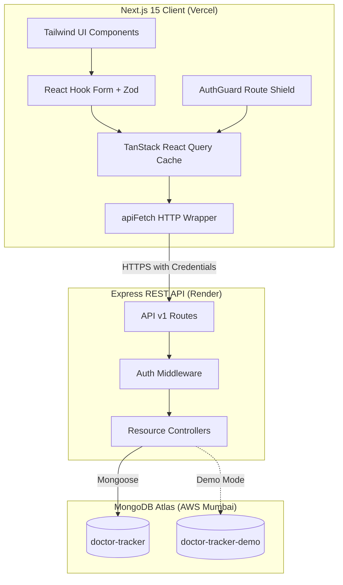

# Doctor Tracker — Frontend Client

[](https://nextjs.org/)
[](https://react.dev/)
[](https://tailwindcss.com/)
[](https://tanstack.com/query)
[](LICENSE)

> A fast, modern healthcare administration dashboard built with Next.js 15, Tailwind CSS, and TanStack Query. Designed for practice managers and administrators to organize doctors, coordinate patient rosters, track assignments, and visualize clinic operations in real time.

---

### 🔗 Live Links

- **Production Web App:** [https://doctor-tracker-client-sepia.vercel.app](https://doctor-tracker-client-sepia.vercel.app)
- **Backend API Service:** [https://doctor-tracker-server-29dm.onrender.com](https://doctor-tracker-server-29dm.onrender.com)
- **API Base URL:** `https://doctor-tracker-server-29dm.onrender.com/api/v1`
- **Backend GitHub Repo:** [shahed-hassan-fz-rabbi/doctor-tracker-server](https://github.com/shahed-hassan-fz-rabbi/doctor-tracker-server)

---

## Table of Contents

- [About the Project](#about-the-project)
- [Application Preview & Screenshots](#application-preview--screenshots)
- [Key Features](#key-features)
- [User Roles & Access Control](#user-roles--access-control)
- [Core Workflows](#core-workflows)
  - [Dashboard Overview](#dashboard-overview)
  - [Doctor Management](#doctor-management)
  - [Patient Management](#patient-management)
  - [Search, Filtering, Sorting & Pagination](#search-filtering-sorting--pagination)
  - [Analytics & Visualizations](#analytics--visualizations)
- [Authentication & Security](#authentication--security)
- [Demo Mode & Isolated Sandbox](#demo-mode--isolated-sandbox)
- [Technology Stack](#technology-stack)
- [Project Architecture](#project-architecture)
- [Folder Structure](#folder-structure)
- [Local Development Setup](#local-development-setup)
- [Environment Variables](#environment-variables)
- [Testing & Quality Assurance](#testing--quality-assurance)
- [Production Deployment (Vercel)](#production-deployment-vercel)
- [Roadmap & Future Enhancements](#roadmap--future-enhancements)
- [Author & Acknowledgments](#author--acknowledgments)

---

## About the Project

Running a modern outpatient clinic or hospital department requires keeping track of dozens of medical specialists and hundreds of patients across changing schedules and diagnoses. Spreadsheets quickly fall apart when multiple administrators need to assign patients, filter by medical condition, reallocate caseloads, or spot bottlenecks in department capacity.

**Doctor Tracker** solves this problem by providing a clean, single-pane-of-glass administrative interface. It connects to a secure, standalone Express and MongoDB backend over REST, completely decoupling UI rendering from database transactions.

---

## Application Preview & Screenshots

All screenshots below represent the actual application interface running with realistic synthetic clinical records.

### Dashboard & Analytics

| Operational Dashboard | Clinical Analytics |
|:---:|:---:|
|  |  |
| *Real-time KPI metric tiles, recent assignments, and workload breakdown.* | *Interactive Recharts for patient growth, conditions, and specializations.* |

### Doctors & Patients Management

| Doctors Directory | Patients Directory |
|:---:|:---:|
|  |  |
| *Status badges, hospital affiliations, contact info, and active patient counts.* | *Server-paginated patient records with assignment badges and diagnosis tags.* |

### Detail Views & Single Sign-On

| Doctor Profile & Roster | Secure Authentication |
|:---:|:---:|
|  |  |
| *Full doctor dossier, assigned patient table, and one-click unassign controls.* | *Dual sign-in: Email/Password, Google OAuth 2.0, and instant demo fill.* |

### Responsive Mobile Experience

| Mobile Dashboard | Mobile Directory |
|:---:|:---:|
|  |  |
| *Collapsible navigation, responsive cards, and touch-friendly controls.* | *Condensed table cards optimized for tablet and smartphone viewports.* |

---

## Key Features

- **Responsive Administrative Interface:** Built from scratch using modern Tailwind CSS with a healthcare-focused ivory/forest/lime palette.
- **Optimized Server-Side Pagination:** Handles large datasets gracefully with debounced search, query caching, and configurable page sizes.
- **Relational Doctor-Patient Workflows:** Assign patients to doctors during creation or editing, or directly from a doctor's profile page. Unassigning frees the patient without destroying clinical history.
- **Interactive Data Visualizations:** Custom Recharts components illustrate patient growth trends, diagnosis distributions, doctor specialization ratios, and caseload loads.
- **Dual Authentication Modes:** Admin email/password login plus Google OAuth 2.0 with backend JWT session cookies.
- **Zero-Trust Session Verification:** Sessions are managed through `HttpOnly`, `SameSite=None`, `Secure` cookies. Zero sensitive tokens are ever persisted in `localStorage` or `sessionStorage`.
- **Dedicated Read-Only Demo Mode:** Safe public sandbox with synthetic records, read-only UI indicators, and write action gating.
- **Robust Client Validation:** Forms use `react-hook-form` with `zod` schemas for real-time error feedback before hitting the network.

---

## User Roles & Access Control

| Role | Permissions | Available Actions |
|---|---|---|
| **Admin** | Full read & write access | Create/edit/delete doctors and patients, manage assignments, view all analytics, access settings. |
| **Viewer (Google OAuth)** | Authenticated read-only | Redirected to `/restricted` until promoted by a system administrator. Prevents unauthorized viewing of patient lists. |
| **Demo Viewer** | Read-only demo access | Explore dashboard, roster, and analytics. Add/Edit/Delete buttons are disabled; API independently enforces 403 on writes. |

---

## Core Workflows

### Dashboard Overview
The dashboard greets the administrator with high-level summary statistics:
- **Total Registered Doctors** and **Active Staff**
- **Total Patients**, **Assigned Cases**, and **Unassigned Waitlist**
- Quick visual shortcuts to register new personnel or intake new patients.
- Recent patient registration list with assigned doctor tags.

### Doctor Management
- **Directory:** Search by name or hospital, filter by clinical specialization (Cardiology, Neurology, Pediatrics, etc.), and toggle active/inactive status.
- **Profile Dossier:** Displays direct contact information, clinic/hospital affiliation, and a live sub-table of all patients currently under their care.
- **Roster Controls:** Administrators can quickly reassign or unassign patients directly from the doctor's profile.

### Patient Management
- **Intake Flow:** Capture patient name, age, gender, phone, email, and preliminary medical condition.
- **Doctor Assignment:** Select an active doctor from a dynamic dropdown during creation, or leave unassigned to triage later.
- **Direct Filtering:** Filter patients by assigned status (All, Assigned, Unassigned) or specific medical diagnoses (e.g., Diabetes, Hypertension, Asthma).

### Search, Filtering, Sorting & Pagination
To ensure fast performance over hundreds of records:
- Search input uses debounced query state so API calls aren't triggered on every keystroke.
- Active filters and pagination parameters synchronize with URL search params, allowing bookmarkable and shareable views.
- TanStack Query keeps stale queries cached in memory for snappy navigation back and forth between records.

### Analytics & Visualizations
Powered by Recharts:
- **Patient Registration Growth:** Area chart displaying monthly patient intake over time.
- **Patients by Condition:** Donut/Pie charts categorizing patient counts across major conditions.
- **Doctor Specializations:** Bar charts breaking down department coverage.
- **Caseload Distribution:** Histogram showing how many patients are assigned to each doctor.

---

## Authentication & Security



1. **HttpOnly Cookies:** Authentication tokens are stored inside browser cookies flagged with `HttpOnly`, `SameSite=None` (for cross-domain Vercel ↔ Render), and `Secure`. JavaScript has no access to the raw token, defending against XSS token theft.
2. **AuthGuard Component:** Wraps all `(dashboard)` routes. If `/auth/me` returns 401, the user is immediately redirected to `/login` with an intuitive flash message.
3. **Automatic 401 / 403 Interceptor:** The centralized `apiFetch` helper intercepts unauthorized or forbidden responses, triggering reactive logout or redirecting viewers to `/restricted`.

---

## Demo Mode & Isolated Sandbox

For reviewers, evaluators, and portfolio demonstration:
- **Demo Credentials:**
  - **Email:** `demo@doctortracker.com`
  - **Password:** `Demo@123`
- A single-click **"Fill Demo Credentials"** button on `/login` automatically populates these inputs.
- When built with `NEXT_PUBLIC_APP_ENV=demo`, the client displays a persistent top banner:
  > *"Demo Mode — You can explore all features, but changes are disabled."*
- Write buttons ("Add Doctor", "Add Patient", "Delete", "Edit") are either visually hidden or replaced with informational tooltips.

---

## Technology Stack

| Category | Technology | Purpose |
|---|---|---|
| **Framework** | Next.js 15 (App Router) | React framework with fast SSR, streaming, and file-based routing |
| **Language** | JavaScript (ESNext) | Clean, modern vanilla JavaScript |
| **Styling** | Tailwind CSS v4 | Utility-first responsive design system |
| **Data Fetching** | TanStack Query v5 | Server state caching, background refetching, and query invalidation |
| **Forms & Validation** | React Hook Form + Zod | Controlled form performance with schema-based validation |
| **Charts** | Recharts v3 | Responsive SVG-based clinical charts and histograms |
| **Icons & Animation** | Lucide React + Framer Motion | Crisp healthcare iconography and fluid page transitions |
| **Testing** | Vitest + Testing Library | Fast unit and component test runner |

---

## Project Architecture



---

## Folder Structure

```text
doctor-tracker-client/
├── docs/
│   └── screenshots/          # Application screenshot assets
├── public/
│   └── images/               # Brand logos and static icons
├── src/
│   ├── app/
│   │   ├── (dashboard)/      # Protected administrative route group
│   │   │   ├── analytics/    # Clinical analytics & charts page
│   │   │   ├── dashboard/    # Primary operations overview
│   │   │   ├── doctors/      # Doctors list, new, [id] details & edit
│   │   │   ├── patients/     # Patients list, new, [id] details & edit
│   │   │   ├── profile/      # Administrator profile view
│   │   │   ├── restricted/   # Viewer account awaiting role elevation
│   │   │   └── settings/     # Clinic settings & preferences
│   │   ├── auth/
│   │   │   └── callback/     # Google OAuth redirect handler
│   │   ├── login/            # Authentication page with demo autofill
│   │   ├── layout.jsx        # Root application layout
│   │   ├── not-found.jsx     # Friendly 404 page
│   │   └── page.jsx          # Root redirector to /dashboard
│   ├── components/
│   │   ├── layout/           # Sidebar, Topbar, AuthGuard, Layouts
│   │   └── ui/               # Cards, Buttons, Tables, Badges, Toast
│   ├── features/
│   │   ├── doctors/          # Doctor schemas and form helpers
│   │   └── patients/         # Patient schemas and form helpers
│   ├── hooks/                # Custom React Query hooks (useAuth, useDoctors, etc.)
│   ├── lib/                  # apiFetch wrapper, demoAccess policy, utility functions
│   └── styles/               # Global CSS & Tailwind imports
├── vitest.config.mjs         # Test runner configuration
└── package.json
```

---

## Local Development Setup

### Prerequisites
- **Node.js**: `v20.0.0` or newer
- **npm**: `v10.0.0` or newer
- Running instance of the **Doctor Tracker Backend API** (locally on port 4000 or hosted on Render)

### Step 1: Clone the Repository
```bash
git clone https://github.com/shahed-hassan-fz-rabbi/doctor-tracker-client.git
cd doctor-tracker-client
```

### Step 2: Install Dependencies
```bash
npm ci
```

### Step 3: Configure Environment Variables
Create a local `.env.local` file by copying the template:
```bash
cp .env.example .env.local
```
Edit `.env.local` to point to your backend API:
```env
NEXT_PUBLIC_API_URL=http://localhost:4000/api/v1
```

### Step 4: Run the Development Server
```bash
npm run dev
```

Open [http://localhost:3000](http://localhost:3000) in your browser.

---

## Environment Variables

| Variable | Description | Example (Local) | Example (Production) |
|---|---|---|---|
| `NEXT_PUBLIC_API_URL` | Base URL of the Doctor Tracker Express API | `http://localhost:4000/api/v1` | `https://doctor-tracker-server-29dm.onrender.com/api/v1` |
| `NEXT_PUBLIC_APP_ENV` | Mode flag (`production` or `demo`) | `production` | `production` |
| `NEXT_PUBLIC_DEMO_API_URL` | Base URL for isolated demo backend *(demo builds only)* | `http://localhost:4000/api/v1` | `https://doctor-tracker-demo.onrender.com/api/v1` |
| `NEXT_PUBLIC_DEMO_AVAILABLE`| Toggles demo credentials card visibility | `true` | `true` |
| `NEXT_PUBLIC_DEMO_EMAIL` | Public demo account username | `demo@doctortracker.com` | `demo@doctortracker.com` |
| `NEXT_PUBLIC_DEMO_PASSWORD`| Public demo account password | `Demo@123` | `Demo@123` |

> [!IMPORTANT]
> Because `NEXT_PUBLIC_*` variables are embedded into the client JavaScript bundle, never store secret keys, database URIs, or administrative credentials here.

---

## Testing & Quality Assurance

The frontend contains a full test suite built with Vitest and React Testing Library covering schema validations, API error interceptors, demo permissions, and UI components.

Run all tests:
```bash
npm test
```

Run tests in watch mode during development:
```bash
npm run test:watch
```

Run Next.js production build verification:
```bash
npm run build
```

---

## Production Deployment (Vercel)

The client is configured for seamless deployment to **Vercel**:

1. Link the repository `shahed-hassan-fz-rabbi/doctor-tracker-client` in the Vercel dashboard.
2. Select **Next.js** as the Framework Preset.
3. Configure the Production Environment Variables:
   - `NEXT_PUBLIC_API_URL`: `https://doctor-tracker-server-29dm.onrender.com/api/v1`
4. Deploy the `main` branch.
5. In your backend Render service, ensure the exact Vercel deployment URL is included in the `CORS_ORIGINS` and `FRONTEND_ORIGIN` environment variables.

---

## Roadmap & Future Enhancements

- [ ] **Appointment Scheduling & Calendar View:** Allow administrators to book, reschedule, and manage appointment slots.
- [ ] **Prescription & Medical Notes History:** Enable doctors to append timestamped consultation notes to patient profiles.
- [ ] **Role Management Dashboard:** An admin panel to promote Google OAuth viewers to full administrators.
- [ ] **CSV / PDF Export:** One-click data export for patient records, roster listings, and monthly analytics reports.
- [ ] **Dark Mode Theme:** Complement the current clean ivory palette with an eye-friendly dark mode.

---

## Author & Acknowledgments

- **Developed by:** Shahed Hassan ([@shahed-hassan-fz-rabbi](https://github.com/shahed-hassan-fz-rabbi))
- **Backend API:** [doctor-tracker-server](https://github.com/shahed-hassan-fz-rabbi/doctor-tracker-server)
- **Built with:** Next.js, Tailwind CSS, TanStack Query, and MongoDB.

---

*Doctor Tracker — Reliable, Secure Healthcare Administration.*
